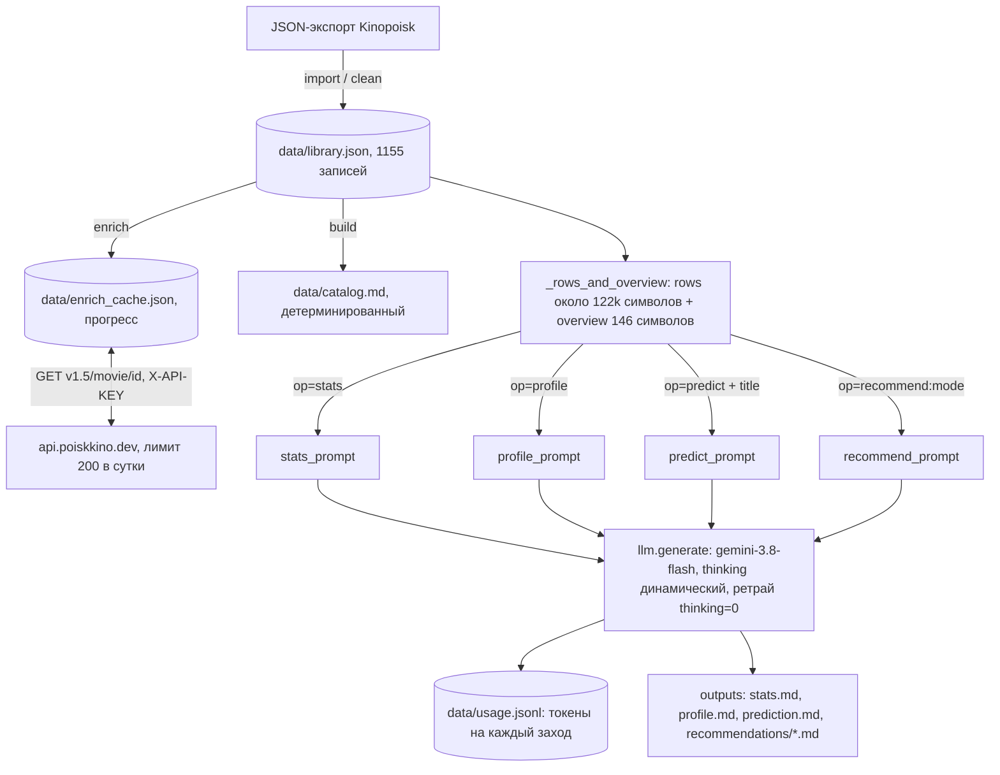

# Project Architecture & LLM Efficiency Audit — cine-compass

Дата аудита: 2026-11-10. Метод: чтение исходников, живые замеры (лог `data/usage.jsonl`,
разовые probe-запросы, программные сверки). Всё, что не измерено, помечено явно.
Секреты отредактированы; личные данные пользователя (названия его записей) не приводятся.

---

## 1. Executive Summary

cine-compass — личный CLI-сервис кинобиблиотеки: импорт экспорта «Кинопоиска», нормализация
и дедупликация, обогащение метаданными через внешнее API, детерминированный маркдаун-каталог
и четыре LLM-операции: статистика, профайл зрителя, прогноз личной оценки («predict»),
подборка «что посмотреть сейчас» («recommend»).

Ключевой факт: **все четыре LLM-операции получают один и тот же вход** — компактную выгрузку
всей библиотеки (1155 строк, около 122 тыс. символов, примерно 48–55 тыс. токенов).
Замер на живом запросе `predict`: 63 580 prompt-токенов при ответе в 50 токенов —
свыше 99 % затрат приходится на вход. При этом программно посчитанная сводка
(топ жанров, десятилетия, средние) обрезается до 146 символов и фактически не входит
в промпт: модель пересчитывает агрегаты сама, что приводило к расхождениям с
программной истиной (см. раздел 5).

Приоритетные направления: дешёвые улучшения точности (полная сводка в промпте,
детерминированный матч «уже в списке» перед `predict`), крупная экономия входных токенов
(контекст-фильтр для `predict`), и измерительные пробелы (usage-логирование введено только что,
цен токенов в проекте нет).

Оценка состояния: 7/10 — простая, предсказуемая, аккуратно обработанная архитектура;
входные расходы не оптимизированы, часть решений доверена модели без программной верификации.

---

## 2. Project Overview

- **Назначение**: персональная кинобиблиотека и «кинокуратор» на собственной истории оценок.
- **Сценарии** (CLI, точка входа `main.py::main`, subparsers):
  - `import <файл>` / `clean` — импорт и чистка JSON-экспорта Kinopoisk;
  - `enrich [--limit N]` — дозаполнение записей метаданными через API, возобновляемое;
  - `build` — детерминированный маркдаун-каталог `data/catalog.md`;
  - `stats` / `profile` — LLM-аналитика вкуса → `data/stats.md` / `data/profile.md`;
  - `predict <название…>` — прогноз личной оценки без спойлеров → `data/prediction.md`;
  - `recommend --mode old|new|classics --count N` → `data/recommendations/*.md`.
- **Стек**: Python 3.12 (Windows/PowerShell), `google-genai` (Gemini SDK), `requests`, `python-dotenv`.
- **Внешние сервисы**: Gemini API (модель из `LLM_MODEL`, текущая `gemini-3.8-flash`);
  kinopoisk.dev — `https://api.poiskkino.dev/v1.5/movie/{id}` с заголовком `X-API-KEY`.
- **Структура (только исполнительные модули)**:
  - `main.py` — CLI и композиция всех конвейеров;
  - `cinecompass/config.py` — пути, `.env`, модель, лимиты;
  - `cinecompass/library.py` — чистка, дедуп, компактное представление для промптов;
  - `cinecompass/enrich.py` — HTTP-обогащение и кэш прогресса;
  - `cinecompass/markdown.py` — каталог, программная сводка, экранирование;
  - `cinecompass/llm.py` — единственная точка вызова Gemini, ретрай, лог токенов;
  - `cinecompass/prompts.py` — все 5 промптов;
  - `tests/test_library.py` — 5 unit-тестов.
- **Конфиденциальность**: `.env` и `data/` вне git; полная история просмотров отправляется
  в Google при каждом LLM-вызове (зафиксировано в README, раздел «Заметки»).

Снимок данных (факт, на дату аудита): библиотека — 1155 записей; с полем `genres` — 395;
с описанием — 394; без личной оценки — 6; дублей по `kinopoiskId` — 0; повторных просмотром
(`rewatchCount` > 1) — 0. Объёмы: `library.json` — 756 КБ, `catalog.md` — 209 КБ.

---

## 3. Architecture and Workflow Diagrams

Общий вход всех четырёх LLM-операций — `main.py::_rows_and_overview()`:
1. `library.load_library()` — полный список записей;
2. `library.compact_rows(items)` — строка на запись: «Название (Оригинал) | год | тип |
   оценка | жанры | режиссёры | КП-рейтинг | длительность | дата просмотра [… imdb-id |
   пересмотрено xN]»; пустые поля опускаются, поэтому необогащённые записи короче;
3. `markdown.build_catalog(items).split("### Топ жанров")[0]` — только шапка сводки (146 символов);
4. `llm.generate(prompt, op=…)` — один запрос Gemini, запись usage, запись результата в файл.

Разделение ответственности:
- детерминированно: нормализация и дедуп (`library.clean_items`), обогащение (`enrich.enrich_library`),
  каталог и сводка (`markdown.build_catalog`, `_overview`), экранирование (`markdown._esc`);
- LLM: агрегатный анализ вкуса (`stats`, `profile`), выбор тайтлов (`recommend`),
  матч «уже в списке» и прогноз (`predict`) — модель решает сама, программных
  предварительных проверок у этих веток нет.

---

## 4. LLM Invocation Inventory

Единственный вызов LLM в проекте — `cinecompass/llm.py::generate()`; все операции идут
через него. Модель статическая из конфига, без task-level маршрутизации.

| Операция | Точка | Промпт | Вход | Выход | Токены | Ретрай | Замена детерминикой? |
|---|---|---|---|---|---|---|---|
| stats | `main.py::cmd_stats` | `stats_prompt(rows, overview)` | сводка + все 1155 строк | маркдаун-отчёт около 9 КБ | истор. замер на 2.5-flash: 57 355 вход / 5 468 мысли / 1 230 выход; cached 57 322 | авто-ретрай при пустом тексте, thinking=0 | нет |
| profile | `cmd_profile` | `profile_prompt(rows, overview)` | то же | маркдаун около 6 КБ | не измерено | тот же | нет |
| predict | `cmd_predict` | `predict_prompt(rows, overview, title)` | то же плюс вопрос | короткий блок «Оценка/Почему» либо «уже смотрели» | факт 3.8-flash: 63 580 вход / 442 мысли / 50 выход / 0 cached | тот же | частично: «уже в списке» — да; сам прогноз — нет |
| recommend:mode | `cmd_recommend` | `recommend_prompt(rows, overview, mode, count)` | то же плюс режим | подборка N тайтлов | не измерено | тот же | нет (но возможен префильтр) |

Представительные фрагменты промптов (полные тексты — `cinecompass/prompts.py`):

- `stats_prompt`: «Ты аналитик кинопортретов… Сводка, посчитанная программно: {overview}
  … Полный список: {rows}… Составь глубокий аналитический отчёт: 1. Что зритель любит
  больше всего… 5. Короткий вывод "почерк зрителя"…»
- `predict_prompt`: «1. Если фильм … уже есть в его списке — скажи это сразу: реальная
  личная оценка… 2. Если записи нет — прогноз: „Оценка: X/10“ (целое число) и „Почему“ —
  2-3 предложения… СЮЖЕТ НЕ РАСКРЫВАТЬ: никаких завязок, поворотов и концовок…
  Названия пиши как „Русское название“ (Original Title)…»
- `recommend_prompt`: «…Подбери {count} тайтлов строго из его библиотеки (кроме режима
  classics…)… Для каждого тайтла верни блок: … "Почему сейчас"… "Что подготовиться"…»
- Общий блок `STYLE` (в stats/profile/recommend): «…опирайся только на полученные данные,
  не выдумывай факты о записях, которых нет в списке».

Общие детали вызовов: структурированный вывод не используется (чистый текст, схема не
валидняется); системному промпту инструкции не выделены (всё в одном user-сообщении);
история разговора не хранится; повторное использование прежних результатов отсутствует;
thinking — динамический бюджет (замер мысли-токенов: 442 на живом `predict`; пик 5 468
в ранней probe на `stats`), ретрай — `thinking_budget=0`; ровно один ретрай, других fallback нет.

---

## 5. Context and Token Management

- **Один контекст на все задачи.** `_rows_and_overview()` возвращает идентичный вход
  (121 945 символа rows + 146 символов overview) для stats/profile/predict/recommend.
- **История разговора отсутствует**, но контекст фактически включает всю библиотеку,
  поэтому каждый новый запрос платит те же ~60 тыс. prompt-токенов заново:
  5 подряд вызовов `predict` — 5 повторов примерно одинаковых 122 тыс. символов.
- **Implicit cache Gemini** подтверждался фактом: `cached_content_token_count = 57 322`
  из 57 355 при повторных вызовах той же ноды (probe 2.5-flash, 2026-11-09).
  На разнесённых по времени запросах 3.8-flash `cached_tokens = 0` — кэш срабатывает
  только на близко расположенных сериях, гарантий нет.
- **Сводка отброшена** (сочетание потери точности и лишней работы): `build_catalog`
  вычисляет топ-15 жанров, распределение по десятилетиям и средние, но
  `_rows_and_overview` обрезает их через `split`, и модель получает 146 из ~1300 символов
  сводки, пересчитывая всё по 1155 строкам. Измеренное следствие: модельный ответ
  «средняя по сериалам 7.64» против программной истины 8.19 (probe 2.5-flash);
  программный расчёт: фильмы 7.47 (n=1061), сериалы 8.19 (n=88).
- **Объёмных данных в промпте нет**: описания (до 300 символов, есть у 394 записей),
  страны, возрастной рейтинг и IMDb-рейтинг в `compact_rows` не входят — больших JSON/HTML
  в промпте нет (проверено по коду).
- **Повтор инструкций**: блок `STYLE` скопирован в три промпта — расход несущественный.
- **Экранирование в промпт-строках отсутствует**: `markdown._esc` защищает таблицы каталога
  от `|`/`[`/`]`, но не применяется в `compact_rows`; названия с такими символами могли бы
  ломать строки. В фактических данных таких названий не обнаружено, риск низкий.

Главные источники лишних токенов, по убыванию:
1. полная выгрузка rows для всех четырёх операций (до ~55 тыс. токенов на вызов);
2. отброшенная часть программной сводки (модель повторяет счёт, вылетая из детальной точности);
3. случай «уже смотрели» в `predict` обслуживается полным LLM-вызовом вместо бесплатного
   программного lookup.

---

## 6. Model Selection

- Доступные модели (ListModels по ключу, 2026-11-09): семейства 2.5-flash, 3-flash-preview,
  3.1/3.5/3.6/3.7/3.8-flash, 3.1-pro и прочие.
- Выбор: статический через `LLM_MODEL` (текущая `gemini-3.8-flash`), динамической
  маршрутизации нет.
- Единственный сравнительный факт качества: на программно проверяемом вопросе
  (средняя оценка по сериалам) 2.5-flash ответил 7.64 при истине 8.19 (ошибка 0.55),
  3.8-flash — около 8.3 (ошибка около 0.11). Замер единичный, выводы о superiority
  по остальным задачам невозможны.
- Паттерн «дешёвый классификатор → сильное рассуждение» в проекте не реализован;
  `predict` теоретически подходил бы для дешёвой модели, но без benchmark это спекуляция.

---

## 7. Accuracy and Reliability

Реализованные механизмы:
- нормализация и дедуп входных данных (`clean_items`): поведение закреплено тестами
  (свежая дата приоритетна; при равных датах остаётся первая оценка);
- внешние данные только по прямому идентификатору `kinopoiskId`; HTTP-ветки 403/429
  обрабатываются как мягкий стоп с сохранением прогресса (факт: запуск 2026-11-10
  остановился на 200-м запросе, в кэше 395 записей, 0 ошибок);
- лог токенов на каждый заход (`_log_usage`): ts, op, model, prompt/thoughts/output/cached, retry;
- экранирование вывода каталога (`_esc`).

Места, где LLM-вывод принимается без независимой проверки:
1. матч «уже в списке» в `predict` — программного lookup нет; модель отвечает верно
   в проверенных случаях («Криминальное чтиво» → 10/10, дата совпала, «Аватар» → 10/10),
   но гарантии нет;
2. агрегаты в stats/profile не сверяются с программными (и программные не доходят в промпт);
3. тайтлы в recommendations не проверяются программно на принадлежность библиотеке;
4. формат «Оценка: X/10» не валидируется парсером — корректность структурированного
   выхода держится только на дисциплине модели.

Идемпотентность и обработка ошибок: `enrich` идемпотентен (кэш по ID);
`stats.md`/`profile.md`/`prediction.md` перезаписываются без версий (истории точности нет,
кроме ручных копий `_v2.5flash` / `_v3.8flash_prev`, созданных в процессе эксплуатации);
recommendations сохраняют timestamp и `*_latest.md`.

---

## 8. External Integrations

### kinopoisk.dev (обогащение)
- Цель: жанры, страны, режиссёры, рейтинг КП/IMDb, длительность, описание (до 300 симв.),
  возрастной рейтинг.
- Условие вызова: только ручная команда `enrich`; LLM выбор не участвует.
- Ввод/вывод: GET `https://api.poiskkino.dev/v1.5/movie/{kp_id}` + `X-API-KEY`; `_extract`
  собирает 10 полей; ответ JSON.
- Фильтрация до вхождения в контекст: описание обрезано лимитом (300 симв.); в LLM-промпт
  описание и страны не попадают вообще (только в файл библиотеки).
- Батчинга нет: один вызов на запись; multi-values эндпоинт мог бы обслуживать около 50 ID
  за запрос (не реализовано; потенциальная экономия запросов примерно в 50 раз).
- Лимиты: демо-тариф — 200 запросов/сутки; 403/429 обрабатываются как лимит с сохранением.
- Факт: за 2026-11-10 — 200 новых записей, 0 ошибок.

### Google Gemini
- Только генерация текста; tool-calling отсутствует; выбор «когда звать» — ручной (команды CLI).

---

## 9. Performance and Cost

| Показатель | Значение | Источник |
|---|---|---|
| LLM-вызовов на операцию | 1 (плюс 1 ретрай при пустом тексте; живых случаев после фикса нет) | код + usage |
| predict: вход / мысли / выход / cached | 63 580 / 442 / 50 / 0 | usage.jsonl, 2026-11-10 |
| stats (истор., 2.5-flash) | 57 355 / 5 468 / 1 230; cached 57 322 | разовая probe 2026-11-09 (лог введён позже) |
| profile, recommend на 3.8-flash | не измерено | — |
| Latency (avg/worst) | не измерено (таймингов в коде нет) | — |
| Денежная стоимость запроса | неизвестна: цены токенов в проекте отсутствуют | — |
| Внешнее API poiskkino | 1 вызов на запись; полный проход ~1155 вызовов (6 дневных сессий по 200) | CLI-логи только |
| Cache hit rate | не ведётся; implicit cache наблюдался один раз | probe |
| Ретраи LLM | 0 фактически с момента фикса; механизм — один ретрай с thinking=0 | usage.jsonl |

Недостающая инструментация для замыкания метрик: тайминги запросов в usage.jsonl,
прайсинг токенов по тарифу пользователя, счётчик cache-hit, фикс. benchmark-набор.

---

## 10. Testing and Observability

Тесты — 5 unit-тестов (`tests/test_library.py`):
1. дедуп по `kinopoiskId` и приоритет свежей даты;
2. нормализация нечисловых полей → None;
3. `compact_rows` не оставляет пустых полей;
4. семантика `duration` (минуты, а не «сезоны»);
5. `_log_usage` пишет JSONL-строку с op/prompt_tokens/thoughts_tokens/retry.

Не покрыто:
- промпты (5 функций `prompts.py`) — нет регрессионных тестов структуры промпта;
- `markdown._esc` для `[`/`]`;
- HTTP-ветки `enrich_library` (403/429/ValueError-пути);
- `build_catalog` (проверялся вручную в ходе аудита);
- LLM-поведение на фиксированном входе (benchmark отсутствует).

Observability:
- `usage.jsonl` — построчные записи по каждому вызову (введён 2026-11-10);
- файлового журнала иного нет — только консольные print;
- счётчик failed у обогащения и общая сводка в конце — да; трейс — нет;
- перезаписываемые outputs не оставляют истории точности по времени.

Зазоры, мешающие объективной оценке accuracy/cost: нет фикс. benchmark-набора;
нет цен токенов; нет latency; usage только начинает накапливаться.

---

## 11. Prioritized Optimization Opportunities

### A. Низкий риск (экономия без потери точности)

**A1. Полная программная сводка в промпт.**
- Текущая реализация: сводка обрезана до 146 символов (`split("### Топ жанров")`).
- Проблема: модель пересчитывает агрегаты по 1155 строкам; зафиксированное расхождение
  с истиной (7.64 vs 8.19).
- Предложение: передавать полный overview (~1.5 тыс. символов, около 500 токенов).
- Влияние: + примерно 500 токенов входа; расчёты сойдутся с программными; меньше лишней
  работы модели.
- Риски/трейд-офф: низкие. Сложность: **Low**.
- Evidence: `main.py::_rows_and_overview`, `cinecompass/markdown.py::_overview`.

**A2. Детерминированный матч «уже в списке» перед `predict`.**
- Текущая реализация: LLM решает сам при полном входе.
- Предложение: нормализованный lookup по `title`/`originalTitle` в `cmd_predict` до вызова
  LLM; попадание — ответ без LLM (0 токенов), промах — текущий путь.
- Влияние: полная цена операций на повторах просмотра уходит в 0; точность ответа гарантирована данными.
- Риски: низкие. Сложность: **Low**. Evidence: `main.py::cmd_predict`.

**A3. `predict` с thinking прямо на нуле.**
- Текущая реализация: динамический thinking; ретрай уже без thinking.
- Предложение: thinking_budget=0 сразу для predict (ответ там порядка 50 токенов).
- Влияние: минус 0.4–5.5 тыс. мысли-токенов на вызов; ниже latency.
- Сложность: **Low**. Evidence: `llm.py::generate`, замеры usage.jsonl/probe.

### B. Архитектурные улучшения

**B1. Контекст-фильтр для `predict`.**
- Предложение: программный ренкинг библиотеки по близости к запрошенному названию
  (пересечение жанров с высокооценёнными группами, совпадение режиссёров, десятилетие)
  → подвыборка 100–150 записей + полная сводка.
- Влияние: вход `predict` падает с ~63 тыс. до ~8–12 тыс. токенов (в 5–8 раз).
- Риски/трейд-оффы: средние — жанры есть только у 395/1155 записей (обогащение идёт),
  необогащённые записи выпадут из ренкинга; вкусовые сигналы по режиссёрам/эпохам
  могут быть учтены не полностью. Требуется фикс-benchmark для проверки качества.
- Сложность: **Medium**. Evidence: `cmd_predict`, `library.py`, `enrich.py` (ограничение полноты).

**B2. Разнесение промптов и входов по задачам** — легкий рефактор: общий блок `STYLE`
вынести в функцию, не дублировать; вход для predict сузить (см. B1), для stats/profile/
recommend оставить полный.

### C. Модельная оптимизация

**C1. Task-уровневая маршрутизация (дешёвая модель для `predict`, сильная для `stats`/`profile`).**
- Влияние: снижение стоимости операций, совершаемых чаще всего.
- Риски: требует benchmark (единственный замер показал, что дешёвая модель ошибалась
  в агрегатах — факты из раздела 6). Реализовывать только после E3.
- Сложность: **Medium** (сначала нужна измерительная инфраструктура).

### D. Accuracy improvements

**D1. Программная верификация названий в выходе LLM.**
- Предложение: после `generate` — сверить упомянутые тайтлы с библиотекой
  (title/originalTitle, нормализация); при несоответствии — ретрай с уточнением либо
  пометка в файле результата.
- Влияние: гарантия «нет вымышленных названий» для recommend/predict;
  для stats — чистота ссылок на записи.
- Риски: возможно дополнительная latency при срабатывании. Сложность: **Medium**.
- Evidence: `llm.py::generate`; сейчас анти-галлюцинация обеспечена только текстом `STYLE`.

**D2. Сверка агрегатов stats/profile с программными** (после A1) — возможна автоматическая
проверка «средние/топы в отчёте соответствуют программе» с пометками расхождений в файл.

### E. Measurement gaps (без данных объективная оптимизация невозможна)

- **E1. Прайсинг**: цены токенов не хранятся в проекте; нужна либо ручная константа в `.env`
  (цена входа/выхода per model), либо нет расчётов деньгами.
- **E2. Latency**: не замеряется; добавить start/end в `usage.jsonl`.
- **E3. Benchmark-набор**: фикс. сценарии (~30 предиктированных названий: 15 в библиотеке,
  15 вне; по 1 вызову каждого recommend; фикс. библиотека) — без него нельзя объективно
  сравнивать модели и префильтры (B1, C1).
- **E4. Накопление usage.jsonl**: статистика появится со временем (запись одна, 2026-11-10).

---

## 12. Open Questions and Missing Information

1. Тариф и цены токенов аккаунта пользователя неизвестны (вне зоны проекта).
2. Точность stats/profile/recommend на 3.8-flash с текущим кратким промптом — не измерена
   системно (есть только единичные проверки: predict — «ожидали 10/10 по данным» — совпало).
3. Поведение implicit cache на 3.8-flash (размер и lifetime) — не задокументировано.
4. Полнота данных: 760 из 1155 записей ещё без жанров/режиссёров — контекст-фильтры (B1)
   до полного обогащения слепы к этим записям; надо решать после окончания enrich.
5. Историческая точность до введения usage.jsonl не восстановлюится точным образом —
   только косвенно через сохранившиеся файлы `_v2.5flash` / `_v3.8flash_prev` и фактические
   сверки, сделанные вручную (7.64 vs 8.19; «Аватар» 10/10 по факту).

---

## 13. Source File Reference Index

| Файл | Ответственность | Ключевые символы |
|---|---|---|
| `main.py` | CLI: все команды, общий вход LLM-операций | `main`, `_rows_and_overview`, `cmd_*` |
| `cinecompass/config.py` | пути, .env, модель, лимиты | `LLM_MODEL`, `ENRICH_INTERVAL`, `USAGE_FILE`, `DESCRIPTION_MAX_CHARS` |
| `cinecompass/library.py` | чистка, дедуп, compact-rows, duration | `load_export`, `clean_items`, `compact_rows`, `missing_enrichment`, `duration` |
| `cinecompass/enrich.py` | API-обогащение и кэш | `API_BASE`, `_extract`, `enrich_library`, `_apply_cache`, `_save_cache` |
| `cinecompass/markdown.py` | каталог, программная сводка, экранирование | `build_catalog`, `_overview`, `_esc`, `item_row`, `_HEADER` |
| `cinecompass/llm.py` | вызов Gemini, ретрай, usage-лог | `_client`, `_log_usage`, `generate` |
| `cinecompass/prompts.py` | 5 промптов | `STYLE`, `stats_prompt`, `profile_prompt`, `predict_prompt`, `RECOMMEND_MODES`, `recommend_prompt` |
| `tests/test_library.py` | 5 unit-тестов | все |
| `data/usage.jsonl` | лог токенов per request | поля: ts, op, model, prompt_tokens, thoughts_tokens, output_tokens, cached_tokens, retry |
| `data/library.json` (вне git) | полная библиотека | 756 КБ |
| `data/enrich_cache.json` (вне git) | кэш API (прогресс) | 395 записей |

Все количественные утверждения — факты из кода или разовых замеров; прочее явно помечено
«не измерено» / «неизвестно».
